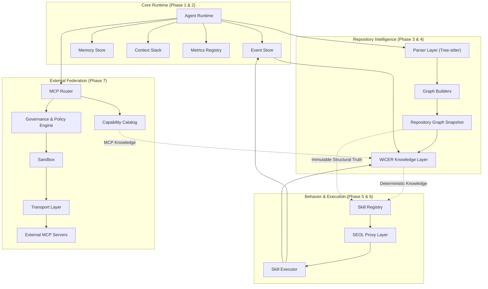

# AgentOS Architecture

## High-Level Overview

AgentOS is designed as a highly deterministic, event-sourced intelligence runtime. It fundamentally decouples core intelligent processing from repository awareness and external capabilities. The architecture enforces strict boundaries to guarantee that the system remains observable, replayable, and safe from unauthorized mutations, both internal and external.

## Architecture Diagram

## Core Architectural Decisions

### 1. Event Sourcing (Phase 2)
**Decision**: The entire system operates on an append-only event stream (`EventStore`), moving away from mutable state transitions.
**Why**: This guarantees determinism, complete provenance tracking, and exact replayability. If a skill or external capability causes an error, the execution narrative can be precisely rebuilt from the event log without assuming state.

### 2. Multi-Language Deterministic Structural Compiler (Phase 3.1)
**Decision**: Switching from TypeScript-only `ts-morph` AST extraction to a multi-language deterministic structural compiler using Tree-sitter.
**Why**: To support a diverse ecosystem while preserving graph integrity. AgentOS relies on the graph (FileGraph, SymbolGraph, DependencyGraph, CallGraph) as the singular source of truth. Using Tree-sitter allowed parsing flexibility without sacrificing structural guarantees.

### 3. Read-Only Knowledge System (WiCER - Phase 4)
**Decision**: Implementing WiCER as a deterministic explanation engine that constructs knowledge strictly out of verified structure (graphs and events), prohibiting LLM-hallucinated reasoning.
**Why**: AgentOS requires explainable behavior. By enforcing a trace-based knowledge generation pipeline, we eliminate hallucinated intent, ensuring everything the system "knows" maps directly to actual codebase artifacts or recorded events.

### 4. SEOL Proxy Layer (Phase 6)
**Decision**: The Skill Execution Optimization Layer (SEOL) intercepts skill execution strictly through JavaScript Proxies, protecting the inputs from mutation and deeply freezing outputs.
**Why**: Skills must remain immutable. SEOL optimizes executions through caching, graph-reuse, and memoization telemetry without rewriting skill AST or altering behavioral logic. This guarantees optimized execution paths have 100% equivalence to raw executions.

### 5. Governed MCP Federation (Phase 7)
**Decision**: External MCP tools and resources are never automatically registered into the native tool registry. They must pass through a strict Governance Policy Engine (`ALLOW`/`ASK`/`DENY`), risk classification, and Sandbox execution layer.
**Why**: External networks are untrusted by default. Direct injection breaks determinism and safety boundaries. The MCP layer acts strictly as an I/O gateway, where capabilities are catalogued and their structural schemas are integrated into WiCER without allowing them to mutate the underlying `RepositoryGraph` or `EventStore` directly.
