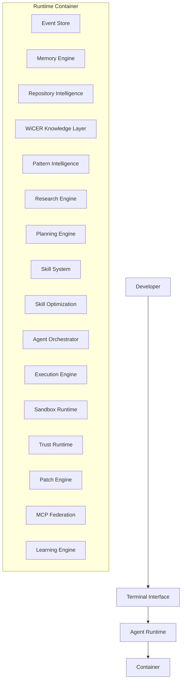
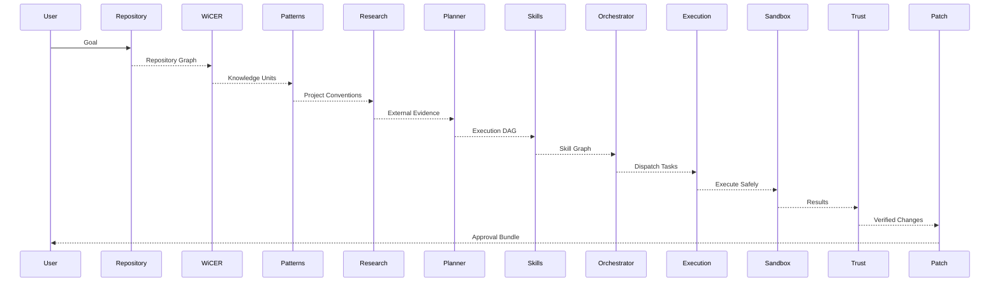

# AgentOS — Complete System Architecture

AgentOS is a **deterministic autonomous software engineering operating system** designed to understand, plan, execute, verify, and improve work inside real software repositories.

Unlike traditional AI agents that rely primarily on prompting and tool calls, AgentOS is built around:

* Event sourcing
* Repository intelligence
* Structural code understanding
* Knowledge compilation
* Pattern learning
* Planning
* Execution orchestration
* Safety verification
* Patch generation
* Runtime optimization
* Multi-agent collaboration

The AI model is treated as a component inside the system, not the system itself.

---

# Architectural Principles

## 1. Repository First

AgentOS never starts from generic AI knowledge.

It starts from the repository itself.

The codebase becomes the primary source of truth.

---

## 2. Structural Understanding

AgentOS understands:

* Files
* Symbols
* Classes
* Functions
* Interfaces
* Dependencies
* Call graphs
* Architecture patterns

through deterministic parsing rather than semantic guessing.

---

## 3. Traceable Intelligence

Every decision can be traced back to:

* Source files
* Graph nodes
* Knowledge units
* Events
* Plans
* Skills
* Execution results

Nothing exists without evidence.

---

## 4. Event-Sourced Runtime

Everything is recorded.

Every:

* Request
* Tool call
* Skill execution
* Plan
* Decision
* Patch

becomes a permanent event.

This enables:

* Replay
* Auditing
* Recovery
* Learning
* Analytics

---

## 5. Safety Before Execution

AgentOS never writes directly to production repositories.

All modifications occur inside isolated environments and must pass verification before approval.

---

# Complete Architecture



---

# Runtime Layer

## Agent Runtime

The runtime is the central request processor.

Responsibilities:

* Accept user goals
* Manage sessions
* Coordinate execution
* Stream results
* Route work into the pipeline

The runtime itself contains almost no business logic.

It acts as an orchestration gateway.

---

# Event Layer

## Event Store

The Event Store is the foundation of the system.

Responsibilities:

* Persist every runtime action
* Maintain immutable execution history
* Enable deterministic replay
* Support auditing and analytics

Examples:

```text
goal.received

plan.generated

skill.executed

patch.generated

trust.validation.completed
```

---

# Memory Layer

## Context Stack

Stores active working memory.

Contains:

* Current session context
* Recent conversations
* Temporary execution state

---

## Memory Engine

Stores durable knowledge.

Examples:

```text
User prefers Bun

Repository uses Prisma

Tests use Vitest

API routes follow REST patterns
```

All memories remain traceable to original events.

---

# Repository Intelligence Layer

## Repository Compiler

AgentOS continuously compiles repositories into structured graphs.

Supported languages:

* TypeScript
* JavaScript
* Python
* Go
* Rust
* Future languages via Tree-sitter

---

## File Graph

Tracks:

```text
Directories
Files
Relationships
```

---

## Symbol Graph

Tracks:

```text
Functions
Classes
Methods
Interfaces
Types
Enums
```

---

## Dependency Graph

Tracks:

```text
Imports
Exports
Modules
Packages
```

---

## Call Graph

Tracks:

```text
Function calls
Method calls
Execution relationships
```

---

## Repository Snapshot

The entire repository becomes a versioned graph model.

```text
RepositoryGraphSnapshot
```

This is the structural source of truth.

---

# Knowledge Layer

## WiCER

Wiki for Code, Execution, and Relationships.

WiCER transforms repository structure into knowledge.

Examples:

```text
Authentication Module

Dependencies:
- JWT Service
- User Repository

Outbound Calls:
- createToken()
```

WiCER never invents information.

Everything is generated from:

* Graphs
* Events
* Provenance chains

---

# Pattern Intelligence Layer

## Pattern Discovery Engine

Discovers repository conventions automatically.

Examples:

### Naming Patterns

```text
Controllers end with Controller

DTOs end with DTO
```

### Folder Patterns

```text
Services in services/

Repositories in repositories/
```

### Validation Patterns

```text
Zod
Joi
Class Validator
```

### Architectural Patterns

```text
Clean Architecture

DDD

MVC

Feature-based
```

---

## Pattern Knowledge Base

Stores reusable project conventions.

Used to ensure generated code matches existing architecture.

---

# Research Layer

## Research Agent

Responsible for acquiring external knowledge.

Sources:

* Documentation
* GitHub repositories
* RFCs
* Standards
* APIs
* MCP resources

Responsibilities:

* Collect evidence
* Summarize findings
* Compare alternatives
* Produce citations

Research is separated from repository intelligence.

---

# Planning Layer

## Planner

Converts goals into execution plans.

Input:

```text
Repository Graph

Knowledge Units

Patterns

Research

Memory

User Goal
```

Output:

```text
Execution DAG
```

Example:

```text
Create OAuth Support

├─ Analyze Authentication
├─ Add Provider
├─ Update Routes
├─ Generate Tests
└─ Verify Integration
```

---

## Plan Verification

Every plan includes:

```text
Dependencies

Required Skills

Risk Assessment

Evidence References
```

---

# Skill System

## Skills

Skills are reusable capabilities.

Examples:

```text
Analyze Dependency Chain

Analyze Impact Radius

Generate Tests

Create Migration

Refactor Imports

Generate Patch
```

---

## Skill Registry

Maintains:

```text
Capabilities

Versions

Dependencies

Permissions
```

---

## Skill Composition

Skills can be combined into larger workflows.

Example:

```text
Impact Analysis
→ Refactor
→ Test Generation
→ Patch Creation
```

---

# Optimization Layer

## Skill Optimization Engine

Observes execution history and improves runtime behavior.

Optimizes:

* Execution ordering
* Cache utilization
* Skill routing
* Resource usage

Never rewrites source code.

Instead it optimizes execution policies.

---

## Learning Database

Stores:

```text
Execution Metrics

Success Rates

Latency

Failure Patterns
```

---

# Orchestration Layer

## Agent Orchestrator

Coordinates work across skills and agents.

Responsibilities:

* Task scheduling
* Dependency resolution
* Retry policies
* Resource management
* Workflow coordination

---

## Multi-Agent Coordination

Supports specialized agents:

### Architect Agent

Designs solutions.

### Research Agent

Acquires information.

### Coding Agent

Produces implementation plans.

### Reviewer Agent

Performs validation.

### Security Agent

Audits safety and risks.

### Test Agent

Generates and validates tests.

---

# Execution Layer

## Execution Engine

Executes plans.

Responsibilities:

* Invoke skills
* Run tools
* Coordinate agents
* Track progress

Everything remains observable.

---

## Execution Graph

Every execution becomes a traceable graph.

```text
Plan
→ Skill
→ Tool
→ Result
```

---

# Sandbox Layer

## Sandbox Runtime

Provides isolated execution environments.

Supports:

### Git Worktrees

```text
Repository cloning
```

### Temporary Workspaces

```text
Ephemeral environments
```

### Containers

```text
Process isolation
```

---

## Security Controls

Restrictions include:

* Workspace boundaries
* File access controls
* Command policies
* Resource limits

---

# Trust Layer

## Trust Runtime

Acts as the system's verification authority.

Responsibilities:

### Claim Validation

```text
Did the implementation actually occur?
```

### Regression Detection

```text
Did anything break?
```

### Evidence Verification

```text
Can every claim be proven?
```

### Risk Analysis

```text
What could fail?
```

---

## Trust Reports

Output:

```text
Trust Score

Evidence

Risks

Recommendations
```

---

# Patch Layer

## Patch Engine

Transforms validated changes into patch bundles.

Output includes:

```text
Diffs

Modified Files

Evidence

Trust Reports

Rollback Instructions
```

---

## Approval Workflow

AgentOS never directly commits changes.

The user receives:

```text
Patch Bundle

Review Summary

Trust Report
```

and decides whether to apply it.

---

# MCP Federation Layer

## MCP Gateway

Provides controlled access to external systems.

Examples:

```text
GitHub

Databases

Documentation Servers

Internal APIs

Cloud Resources
```

---

## Governance Engine

Every MCP capability passes through:

```text
ALLOW

ASK

DENY
```

policies.

No external capability bypasses governance.

---

# Learning Layer

## Learning Engine

Continuously analyzes:

```text
Execution outcomes

Skill performance

Planning quality

Trust scores

User approvals
```

---

## Pattern Evolution

Discovers:

```text
Successful workflows

Failure patterns

Optimization opportunities
```

without modifying repository code automatically.

---

# Decision Provenance System

One of the most important subsystems.

Every decision must answer:

```text
Why?
```

Example:

```text
Why was auth.ts modified?

Repository:
  auth.ts imports jwt.ts

Knowledge:
  Authentication Module

Pattern:
  Existing JWT Architecture

Plan:
  Extend Authentication Flow

Skill:
  GeneratePatch
```

Every action is backed by evidence.

---

# Complete End-to-End Flow



# What AgentOS Ultimately Becomes

AgentOS becomes a **repository-native autonomous software engineering operating system** that can:

* Understand large codebases structurally
* Learn project conventions
* Research external knowledge
* Plan complex engineering tasks
* Coordinate specialized agents
* Execute work safely
* Verify its own claims
* Generate auditable patches
* Explain every decision with evidence
* Continuously optimize its behavior

The result is a system that behaves less like a chatbot and more like a **deterministic engineering organization compressed into a runtime**, where every action is observable, traceable, verifiable, and grounded in the actual software being built.
