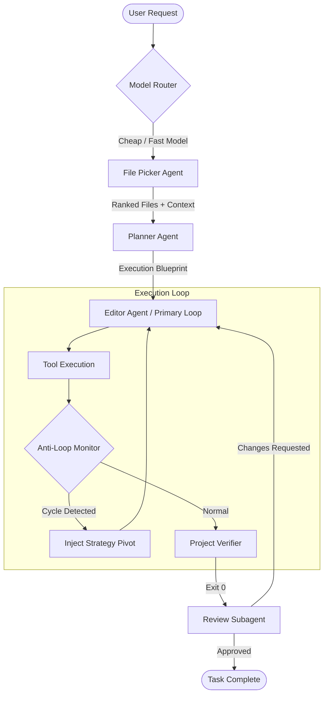

# Plan 01: Multi-Agent Pipeline & Anti-Loop Orchestration

**Status:** Proposed Architecture  
**Inspired By:** Freebuff / Codebuff (File Picker pattern), Qwen Code (Anti-Loop Monitor & Agent Team), OpenCode (Specialized subagents)  
**Target Packages:** `packages/agent-runtime`, `packages/providers`, `packages/config`  
**Strict Directives:** Planning only — zero production code modifications.

---

## 1. Motivation & Problem Statement

Currently, AgentOS executes a largely monolithic agent loop in `AgentLoop.ts`. When a task arrives:
1. `LightweightPlanner` generates a plan using the primary model.
2. The agent loop injects `repo_map` or runs `SearchSubagent` using the primary (often expensive) model.
3. Every turn includes large context payloads, consuming thousands of tokens per step.
4. When facing difficult bugs, the loop lacks automated detection of cyclic thrashing or repeating tool arguments, relying solely on `maxTurns` or `maxWallTimeMs` to terminate.

In contrast, **Codebuff** uses an ultra-fast **File Picker Agent** running a cheap model to isolate the exact 2–5 candidate files before the heavy model ever runs. **Qwen Code** deploys an **Anti-Loop Monitor** that detects when the agent is caught in a circular reasoning loop or repetitive tool execution pattern and forces a strategic pivot.

---

## 2. Architecture Overview



---

## 3. Component Specifications

### 3.1. Fast File Picker Agent (`FilePickerAgent.ts`)

The File Picker Agent runs ahead of the primary reasoning loop to determine the exact files relevant to the user request. It utilizes a fast, inexpensive model (e.g., Claude 3.5 Haiku, DeepSeek Flash, GPT-4o-mini).

#### TypeScript Interface & Design
```typescript
// Proposed path: packages/agent-runtime/src/exploration/FilePickerAgent.ts

export interface FilePickerCandidate {
  path: string;
  relevanceScore: number; // 0.0 to 1.0
  reason: string;
  suggestedAction: 'edit' | 'read_context' | 'test_verify';
}

export interface FilePickerResult {
  candidates: FilePickerCandidate[];
  summary: string;
  durationMs: number;
  tokensUsed: number;
}

export interface FilePickerOptions {
  maxCandidates?: number;
  maxTurns?: number;
  includeRecentGitDiff?: boolean;
}

export class FilePickerAgent {
  constructor(
    private cheapModel: Model,
    private workspaceRoot: string,
    private options: FilePickerOptions = {}
  ) {}

  /**
   * Fast discovery routine using indexed directory heuristic and cheap model
   */
  async discoverRelevantFiles(userInput: string): Promise<FilePickerResult>;
}
```

#### Fast Heuristic Tooling for the File Picker
The File Picker Agent does NOT have access to write, patch, or execute arbitrary terminal commands. It is restricted to high-speed indexing tools:
1. `fast_glob`: Match paths by file pattern (e.g. `src/auth/**/*.ts`).
2. `regex_grep`: Fast ripgrep search for symbol identifiers, function names, and error messages.
3. `outline_symbols`: Extract top-level exports, classes, and types from candidate files without reading entire bodies.

#### Prompt Template for File Picker
```markdown
You are a high-speed code discovery agent.
Your sole job is to locate the exact 2-5 files in this repository needed to address the user request.
Do not write code. Do not implement changes.

Output ONLY a JSON payload matching this schema:
{
  "candidates": [
    {
      "path": "relative/path/to/file.ts",
      "relevanceScore": 0.95,
      "reason": "Defines the authenticateToken middleware that fails on expired refresh tokens",
      "suggestedAction": "edit"
    }
  ],
  "summary": "Brief explanation of the affected subsystem"
}
```

---

### 3.2. Model Role Configuration (`modelRoles`)

To support multi-agent model differentiation, `@agent-os/config` and `@agent-os/providers` must support role-based model assignments:

```typescript
// Proposed schema addition in packages/config/src/schema.ts
export interface AgentModelRolesConfig {
  primary: string;    // e.g. "anthropic/claude-3-5-sonnet-20241022" or "deepseek/deepseek-chat"
  fast: string;       // e.g. "anthropic/claude-3-5-haiku-20241022" or "deepseek/deepseek-flash"
  planning?: string;  // e.g. "openai/o3-mini" or "anthropic/claude-3-7-sonnet"
  review?: string;    // e.g. "anthropic/claude-3-5-sonnet"
}
```

If `fast` is not explicitly configured, fallback gracefully to `primary`.

---

### 3.3. Anti-Loop Monitor (`AntiLoopMonitor.ts`)

Adapted from Qwen Code / Qwen Orchestrator, the Anti-Loop Monitor tracks runtime behavior across turns and halts reasoning loops or edit thrashing.

#### Loop Signals Tracked:
1. **Tool Signature Loops**: Same tool called with identical arguments across turns (`hash(toolName + canonicalArgs)`).
2. **Diff Cycling / Thrashing**: File $A$ is edited, test fails, File $A$ is reverted to previous state, edited again identically.
3. **Repeated Error Outputs**: The same command or verification failure is received 3 times with zero progressive variance.

#### TypeScript Interface & Design
```typescript
// Proposed path: packages/agent-runtime/src/loop/AntiLoopMonitor.ts

export interface ActionRecord {
  turn: number;
  toolName: string;
  argsHash: string;
  outputHash: string;
  filesModified: string[];
}

export interface AntiLoopStatus {
  isLooping: boolean;
  loopType?: 'tool_repetition' | 'diff_thrashing' | 'error_churn';
  repetitionCount: number;
  interventionPrompt?: string;
}

export class AntiLoopMonitor {
  private history: ActionRecord[] = [];
  private readonly REPETITION_THRESHOLD = 3;

  /**
   * Record a tool execution step
   */
  public recordAction(action: {
    turn: number;
    toolName: string;
    args: unknown;
    output: string;
    filesModified?: string[];
  }): AntiLoopStatus {
    const argsHash = this.hashObject(action.args);
    const outputHash = this.hashString(action.output);

    this.history.push({
      turn: action.turn,
      toolName: action.toolName,
      argsHash,
      outputHash,
      filesModified: action.filesModified ?? [],
    });

    return this.evaluate();
  }

  public evaluate(): AntiLoopStatus {
    // 1. Check identical tool call repetition
    const recent = this.history.slice(-this.REPETITION_THRESHOLD);
    if (recent.length === this.REPETITION_THRESHOLD) {
      const allSame = recent.every(
        (r) => r.toolName === recent[0].toolName && r.argsHash === recent[0].argsHash
      );
      if (allSame) {
        return {
          isLooping: true,
          loopType: 'tool_repetition',
          repetitionCount: this.REPETITION_THRESHOLD,
          interventionPrompt: `ANTI-LOOP INTERVENTION: You have executed '${recent[0].toolName}' with identical arguments 3 times consecutively. Stop this repeating query. Analyze what information you are missing and adopt an alternative exploration path.`,
        };
      }
    }

    // 2. Check diff thrashing (editing and reverting the same files)
    // ...
    return { isLooping: false, repetitionCount: 0 };
  }

  private hashObject(obj: unknown): string {
    return crypto.createHash('sha256').update(JSON.stringify(obj || {})).digest('hex').slice(0, 16);
  }

  private hashString(str: string): string {
    return crypto.createHash('sha256').update(str || '').digest('hex').slice(0, 16);
  }
}
```

#### Integration with `AgentLoop.ts`
When `AntiLoopMonitor.evaluate().isLooping === true`:
1. The monitor injects the `interventionPrompt` into the system instructions for the next turn.
2. Injects a temporary `temperature` boost (+0.2) or requests a strategic re-plan from `LightweightPlanner`.
3. Publishes an `agent.loop.anti_loop_triggered` event onto `LoggingEventBus`.

---

## 4. End-to-End Orchestration Flow

1. **Phase 1: Discovery (File Picker)**
   - Run `FilePickerAgent` on `fastModel`.
   - Returns 2–5 `candidateFiles`.
   - Context saved into `LoopState.rankedFiles`.
2. **Phase 2: Planning**
   - Run `LightweightPlanner` targeting *only* the discovered candidate files.
   - Generates minimal execution steps and explicit verification commands.
3. **Phase 3: Execution (Editor / Tool Loop)**
   - Primary loop runs with tool execution monitored by `AntiLoopMonitor`.
   - Edits are sandboxed.
4. **Phase 4: Verification & Review**
   - Project verifier runs baseline & test commands.
   - If tests pass, `ReviewSubagent` performs sanity check on the final diff.
   - If approved, session completes.

---

## 5. Implementation Roadmap (Post-Approval)

| Step | Target File | Description |
| :--- | :--- | :--- |
| 1.1 | `packages/config/src/schema.ts` | Add `modelRoles` schema (`primary`, `fast`, `planning`, `review`) |
| 1.2 | `packages/agent-runtime/src/exploration/FilePickerAgent.ts` | Implement `FilePickerAgent` with cheap model runner and regex/glob tools |
| 1.3 | `packages/agent-runtime/src/loop/AntiLoopMonitor.ts` | Implement `AntiLoopMonitor` for tool repetition and diff cycling detection |
| 1.4 | `packages/agent-runtime/src/loop/AgentLoop.ts` | Wire `FilePickerAgent` into loop initialization and `AntiLoopMonitor` into turn step |
| 1.5 | `packages/agent-runtime/tests/anti-loop-monitor.test.ts` | Add test coverage for cycle detection and intervention triggers |
| 1.6 | `packages/agent-runtime/tests/file-picker-agent.test.ts` | Add unit and mock tests for file candidate ranking and token reduction |
