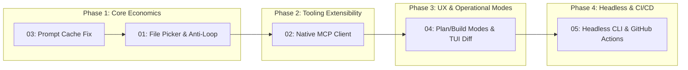

# AgentOS v2 Upgrade Roadmap & Architecture Specifications

**Directory:** `plans/v1/`  
**Date:** 2026-10-08  
**Status:** Architecture & Planning Complete (Zero implementation started — ready for user review)  
**Benchmarked Competitors:**  
- **Freebuff / Codebuff** (`https://freebuff.com/`, `CodebuffAI/codebuff`, `CodebuffAI/freebuff`)
- **OpenCode** (`anomalyco/opencode`)
- **Qwen Code / Qwen-Agent** (`QwenLM/qwen-code`, `QwenLM/Qwen-Agent`)

---

## 1. Executive Roadmap Overview

Following a deep code-level and architectural analysis of Freebuff/Codebuff, OpenCode, and Qwen Code, this directory contains the complete specifications for upgrading **AgentOS** into a next-generation coding agent.

The key innovations planned for AgentOS v2 are:
1. **Multi-Agent Pipeline & File Picker**: Pre-exploring candidate files with fast, low-cost models (Codebuff pattern) to reduce primary reasoning prompt tokens by 60–75%.
2. **Anti-Loop Monitoring**: Tracking tool argument hashes, diff cycling, and error thrashing to automatically break reasoning loops (Qwen Code pattern).
3. **Prefix-Stable Prompt Caching**: Fixing the prompt prefix cache-busting bug in `AgentLoop.ts` to achieve 90%+ prompt cache hit rates on Anthropic, DeepSeek, and OpenRouter.
4. **Native Model Context Protocol (MCP)**: Connecting to any external stdio or SSE MCP server to instantly unlock hundreds of tools (OpenCode pattern).
5. **Dual Plan/Build Modes & Interactive TUI**: Providing clean read-only exploration (`Plan Mode`) vs. write execution (`Build Mode`) with slash commands and terminal diff inspection (OpenCode & Freebuff pattern).
6. **Headless Automation & CI/CD**: Running headless PR reviews and autonomous issue-to-PR resolutions in GitHub Actions.

---

## 2. Plan Document Index

| Document | Focus Area | Key Architectural Deliverables |
| :--- | :--- | :--- |
| [00-competitive-analysis.md](file:///d:/Work/Personal/Cli/agent-os/plans/v1/00-competitive-analysis.md) | **Competitive Analysis** | Feature matrix, source comparison, and architectural gap analysis across Freebuff, OpenCode, Qwen Code, and AgentOS. |
| [01-multi-agent-pipeline.md](file:///d:/Work/Personal/Cli/agent-os/plans/v1/01-multi-agent-pipeline.md) | **Multi-Agent & Anti-Loop** | `FilePickerAgent.ts`, `AntiLoopMonitor.ts`, cheap model routing (`modelRoles`), and minimal diff context passing. |
| [02-mcp-tool-integration.md](file:///d:/Work/Personal/Cli/agent-os/plans/v1/02-mcp-tool-integration.md) | **Native MCP Client** | `McpClientManager.ts`, `McpToolBridge.ts`, `.agentos/mcp.json` schema, stdio/SSE transports, and security governance. |
| [03-context-caching-and-token-economics.md](file:///d:/Work/Personal/Cli/agent-os/plans/v1/03-context-caching-and-token-economics.md) | **Context & Prompt Caching** | Fixing `AgentLoop.ts` lines 312–314, immutable prefix ordering, provider cache breakpoints (`cache_control`), and tool output caps. |
| [04-cli-tui-and-desktop-parity.md](file:///d:/Work/Personal/Cli/agent-os/plans/v1/04-cli-tui-and-desktop-parity.md) | **Interactive TUI & Dual Modes** | Strict `Plan Mode` vs `Build Mode`, slash command engine (`/plan`, `/build`, `/diff`, `/compact`), terminal diff panel, and daemon bridge. |
| [05-github-actions-headless-agent.md](file:///d:/Work/Personal/Cli/agent-os/plans/v1/05-github-actions-headless-agent.md) | **Headless CI/CD Automation** | Non-interactive CLI mode (`--headless`), automated PR review workflow, and `/agentos fix` GitHub Action issue resolver. |
| [06-freebuff-resilience-and-guards.md](file:///d:/Work/Personal/Cli/agent-os/plans/v1/06-freebuff-resilience-and-guards.md) | **Resilience & Zero-Token Compaction** | `TruncatedWriteGuard` (cut-off protection), `MechanicalCompactionEngine` (0-token compaction + working set), `EditLoopGuard`, and `WorkspaceTrustManager`. |

---

## 3. Recommended Phased Implementation Sequence

When authorized to begin implementation, the work should be executed in four controlled, sequential phases:

### Phase 1: Core Token Economics & Loop Resilience (P0)
- **Target**: Fix cache-busting in `AgentLoop.ts`, implement `FilePickerAgent` on fast models, and add `AntiLoopMonitor`.
- **Impact**: Immediate 60–80% reduction in session token costs and elimination of infinite reasoning loops.

### Phase 2: Tool Extensibility via MCP (P1)
- **Target**: Implement `McpClientManager`, `.agentos/mcp.json` parser, and stdio transport.
- **Impact**: Dynamic connection to community tools (PostgreSQL, GitHub, Puppeteer, Docker).

### Phase 3: Developer UX & Dual Modes (P1)
- **Target**: Introduce `Plan Mode` vs `Build Mode` separation, slash command engine, and Ink-based diff viewer.
- **Impact**: Safe, read-only architectural exploration and frictionless terminal interactions.

### Phase 4: CI/CD & Headless Automation (P2)
- **Target**: Add `--headless` CLI flags, JSON output reporting, and GitHub Actions PR review/fix workflows.
- **Impact**: Full autonomous software engineering integration in production repositories.

---

## 4. Evaluation & Verification Strategy

Each phase must be validated against our established quality gates:
1. **Type Safety**: `bunx tsc --noEmit` must return 0 errors.
2. **Unit & Integration Tests**: 100% pass rate on all existing 567 tests plus dedicated test suites for each new component.
3. **Cache Telemetry**: Regression tests confirming `cacheReadInputTokens / totalInputTokens >= 0.85` on turns 2+ with Anthropic/OpenRouter.
4. **Release Gate**: `bun run release:check` passing clean before any milestone commit.

---

> [!NOTE]
> In accordance with user instructions, **no production code changes have been made**. All specifications in this directory are ready for user review and approval before execution commences.
