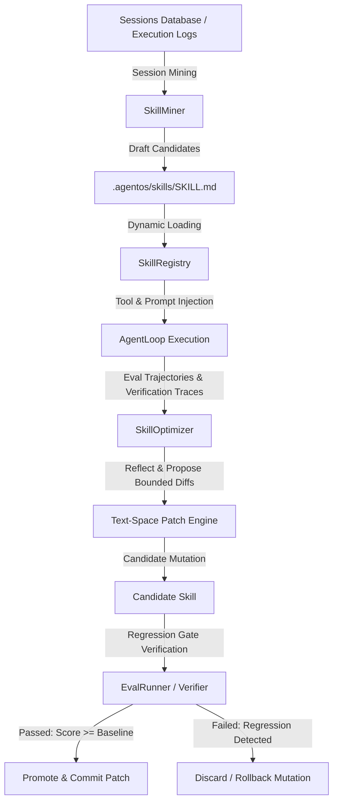

# Plan 08: AgentOS Skills System & Closed-Loop Auto-Optimizer

## Executive Summary & Architectural Heritage

AgentOS integrates a native, production-grade **Skills System** paired with an autonomous **Auto-Generation and Closed-Loop Optimization Engine**. By analyzing the state-of-the-art open-source implementations in **`microsoft/SkillOpt`** and **`hqhq1025/skill-optimizer`**, AgentOS combines the best principles of session trace mining, text-space prompt refinement, and strict evaluation gating.

| Component / Dimension | `microsoft/SkillOpt` | `hqhq1025/skill-optimizer` | **AgentOS Architecture** |
| :--- | :--- | :--- | :--- |
| **Skill Representation** | `best_skill.md` text document | `SKILL.md` with YAML frontmatter + scripts | **`SKILL.md`** with strict YAML metadata, tool allowances, examples, and verification rules |
| **Discovery Mechanism** | Manual path specification | Memory directory scanning | Dynamic hierarchical resolution (`.agentos/skills/`, user global `~/.agentos/skills/`, and workspace) |
| **Generation Origin** | Seed prompts & eval trajectories | Offline session trace mining (`skill-miner`) | **`SkillMiner`**: mines verified sessions from SQLite `sessions.db` to extract reusable workflows |
| **Optimization Method** | **Bounded Textual Patches** (`append`, `insert_after`, `replace`, `delete`) | LLM full-text rewrite | **Bounded Patch Optimization**: preserves structural anchors, avoiding catastrophic forgetting |
| **Safety & Regression Gate** | Held-out validation dataset | Manual user inspection | **Evaluation Benchmark Gate**: candidate skill must pass `evals/tasks/` with $\ge$ baseline score |
| **Runtime Activation** | System prompt injection | Tool/Agent invocation | Native **`load_skill` / `skill`** tools + automatic semantic prompt routing |

---

## 1. System Architecture



---

## 2. Skill Format Specification (`SKILL.md`)

Each skill resides within `.agentos/skills/<skill-name>/SKILL.md` (or `~/.agentos/skills/<skill-name>/SKILL.md` for global skills).

```markdown
---
name: react-component-refactor
description: Best practices and tool recipes for extracting and refactoring React components without breaking hook dependencies
version: 1.0.0
tags: [react, refactoring, typescript]
tools: [read_file, edit_file, repo_map, run_command]
parameters:
  componentPath:
    type: string
    description: Path to target component file
---

# React Component Refactor Skill

## Objective
Extract reusable subcomponents from complex JSX trees while preserving hook order, state locality, and type safety.

## Execution Recipe
1. **Analyze Dependencies**: Run `repo_map` and `read_file` to map imports, custom hooks, and state dependencies.
2. **Verify Baseline**: Run test suite before initiating modifications.
3. **Atomic Extraction**: Extract pure UI leaf elements first using `edit_file`.
4. **Hook Extraction**: Relocate stateful logic into custom hook (`use<Component>State.ts`).
5. **Regression Check**: Run test command via `run_command`.

## Common Pitfalls & Guardrails
- **Unclosed JSX Tags**: Always verify bracket parity before finalizing changeset.
- **Conditional Hook Invocations**: Never place hooks inside loops or conditions.
```

---

## 3. Core Engine Implementations

### 3.1. `SkillRegistry` (`packages/agent-runtime/src/skills/SkillRegistry.ts`)
- Discovers skills from workspace `.agentos/skills/`, user config `~/.agentos/skills/`, and built-in defaults.
- Parses YAML frontmatter and validates tool permissions.
- Exposes `load_skill` and `list_skills` to `AgentRuntime` and `AgentLoop`.

### 3.2. `SkillMiner` (`packages/agent-runtime/src/skills/SkillMiner.ts`)
- Traverses completed session histories in `@agent-os/sessions` where `verificationPassed === true`.
- Filters for high-complexity runs (turns $\ge 3$, tool calls $\ge 4$).
- Uses reflective summarization prompt to extract:
  1. Trigger intent / description
  2. Proven execution recipe
  3. Identified pitfalls and recovery strategies
- Emits candidate `SKILL.md` files for review or automated optimization.

### 3.3. `SkillOptimizer` (`packages/agent-runtime/src/skills/SkillOptimizer.ts`)
- Implements the bounded textual patch optimization protocol from `microsoft/SkillOpt`:
  - **Mutation Operators**:
    - `insert_after(anchorText, newInstructions)`
    - `append_section(title, content)`
    - `replace_block(oldBlock, newBlock)`
    - `delete_block(unnecessaryBlock)`
- Gated rollout:
  1. Clones target tasks from `evals/tasks/` into isolated temporary worktrees.
  2. Runs baseline eval with current skill $\to$ records pass rate $R_{base}$ and wall clock time.
  3. Applies candidate patch $\to$ runs eval with mutated skill $\to$ records $R_{cand}$.
  4. Accepts patch if $R_{cand} \ge R_{base}$ and latency does not degrade by $>15\%$.
  5. Emits detailed diff report and updates skill version.

---

## 4. CLI Subcommands

```bash
# List all registered workspace and global skills
agentos skills list

# Mine recent successful sessions to generate candidate skills
agentos skills mine --limit 10 --out .agentos/skills/

# Run closed-loop optimization on a target skill against eval tasks
agentos skills optimize react-component-refactor --tasks evals/tasks/ --iterations 3

# Validate skill syntax and schema
agentos skills check .agentos/skills/
```

---

## 5. Verification & Testing Strategy

1. **Unit Tests**:
   - `SkillRegistry.test.ts`: Frontmatter parsing, priority overrides, missing skill errors.
   - `SkillMiner.test.ts`: Mining session trajectories, extracting recipes from verified runs.
   - `SkillOptimizer.test.ts`: Bounded patch application, rollback on eval regression, deterministic scoring.
2. **Integration Tests**:
   - Agent loop loaded with skill resolves custom domain tasks faster and with fewer repair attempts.
   - Evaluator verifies that poisoned/failing skill patches are rejected by the regression gate.
