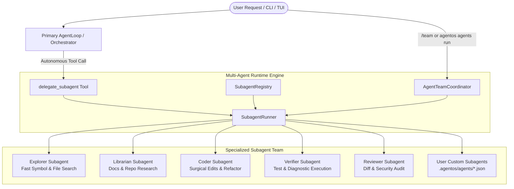

# Plan 09: AgentOS Multi-Agent System & Team Orchestration Engine

## Executive Summary & Architectural Heritage

By analyzing the multi-agent architectures of **Freebuff / Codebuff** (`CodebuffAI/freebuff`), **OpenCode** (`anomalyco/opencode`), and **Qwen Code** (`QwenLM/qwen-code`), AgentOS introduces a native, production-grade **Multi-Agent System & Team Orchestration Engine**.



### Comparative Analysis Matrix

| Dimension | Freebuff (`freebuff`) | OpenCode (`opencode`) | Qwen Code (`qwen-code`) | **AgentOS Architecture** |
| :--- | :--- | :--- | :--- | :--- |
| **Agent Definition** | Static TS declarations in `agents/` | Package-level config | Monorepo agents with ACP | **Declarative `SubagentDefinition`**: name, role, systemPrompt, tool whitelist, model role, maxTurns, output schema |
| **Agent Tool Whitelist** | Scoped tool arrays | Permission layers | Sandboxed tools | **Strict Tool Filter**: tools dynamically filtered from `ToolRegistry` per subagent |
| **Delegation Mechanism** | `run_subagent` / `best-of-n` | `task` tool | `delegate_task` / team protocol | **`delegate_subagent` Tool**: autonomous tool available in `AgentLoop` |
| **Team Coordination** | Sequential hardcoded pipelines | Session forking | Dynamic subagent teams | **`AgentTeamCoordinator`**: parallel & sequential dependency workflows |
| **Context Hygiene** | Scrubbing finished subagent traces | Isolated session storage | Session memory scopes | **`ContextPruner` integration**: intermediate tool traces scrubbed, preserving only structured results |
| **Custom Authoring** | Hardcoded in repository | Limited | Configuration files | **Workspace & User Subagents**: `.agentos/agents/*.json` & `~/.agentos/agents/` |

---

## 1. Core Component Specifications

### 1.1. Subagent Definition Schema (`SubagentDefinition`)
Located at: `packages/agent-runtime/src/multiagent/SubagentModel.ts`

```typescript
export interface SubagentDefinition {
  name: string;
  description: string;
  role: 'explorer' | 'librarian' | 'coder' | 'verifier' | 'reviewer' | 'custom';
  systemPrompt: string;
  modelRole?: 'fast' | 'planning' | 'review' | 'default';
  tools: string[]; // Whitelist of allowed tool names (e.g. ['read_file', 'grep', 'search_symbols'])
  maxTurns?: number; // Bounds execution to prevent infinite subagent loops
  source?: 'builtin' | 'workspace' | 'user';
  filePath?: string;
}
```

### 1.2. Subagent Registry (`SubagentRegistry`)
Located at: `packages/agent-runtime/src/multiagent/SubagentRegistry.ts`
- Discovers built-in specialized subagents:
  1. `explorer`: Read-only tools (`read_file`, `list_dir`, `grep`, `search_symbols`, `repo_map`).
  2. `librarian`: Documentation and repository investigation (`run_command` with git clone bounds, `read_file`).
  3. `coder`: Surgical editing and refactoring (`read_file`, `edit_file`, `write_file`, `load_skill`).
  4. `verifier`: Test execution and diagnostic isolation (`run_command`, `read_file`, `grep`).
  5. `reviewer`: Unified diff review and security sanity checking (`read_file`, `grep`).
- Discovers user/workspace custom subagents in:
  - Workspace: `.agentos/agents/*.json`, `.claude/agents/*.json`, `.agents/agents/*.json`
  - Global User Home: `~/.agentos/agents/*.json`, `~/.claude/agents/*.json`

### 1.3. Subagent Runner (`SubagentRunner`)
Located at: `packages/agent-runtime/src/multiagent/SubagentRunner.ts`
- Executes subagent in an isolated sub-loop.
- Restricts tool registry strictly to the subagent's allowed tool whitelist.
- Uses designated model role (e.g. `fast` model for `explorer`, `review` model for `reviewer`).
- Captures intermediate tool calls and formats concise `SubagentExecutionResult` to prevent context bloat.

### 1.4. `delegate_subagent` Tool
Located at: `packages/tools/src/implementations/delegate_subagent.ts`
- Spec:
  - `agentName`: Target subagent (e.g., `'explorer'`, `'librarian'`, `'coder'`, `'verifier'`, `'reviewer'`)
  - `task`: Specific actionable instruction or query
  - `context`: Optional background context or file paths
- Enables autonomous delegation from within `AgentLoop`.

### 1.5. Team Orchestrator (`AgentTeamCoordinator`)
Located at: `packages/agent-runtime/src/multiagent/AgentTeamCoordinator.ts`
- Orchestrates multi-agent team patterns:
  - **`research-and-implement`**: Parallel exploration (`explorer` + `librarian` in parallel) $\to$ `coder` implementation $\to$ `verifier` + `reviewer`.
  - **`investigate-and-fix`**: `verifier` captures failing traces $\to$ `explorer` locates symbols $\to$ `coder` fixes $\to$ `verifier` confirms green.

---

## 2. CLI & UI Integration

1. **CLI Commands**:
   - `agentos agents list`: Display all registered built-in and user subagents.
   - `agentos agents run <agent-name> --task <task>`: Run an isolated subagent directly.
   - `agentos agents team --workflow <workflow> --goal <goal>`: Run a coordinated team workflow.

2. **Interactive Slash Commands**:
   - `/agents`: List all available subagents and their allowed tools.
   - `/team [workflow] [goal]`: Trigger an autonomous multi-agent team workflow.

---

## 3. Verification & Safety Gates

1. **Isolation**: Subagent execution failures must not crash the primary `AgentLoop`.
2. **Context Safety**: Subagent raw tool outputs are bounded and scrubbed via `ContextPruner`.
3. **Tool Scoping**: A subagent with `tools: ['read_file']` must be strictly forbidden from executing `edit_file` or `run_command`.
4. **100% Test Pass Rate**: Full unit and integration test coverage across the entire test harness.
